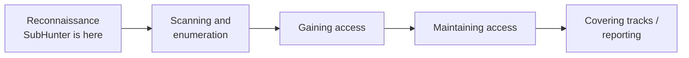
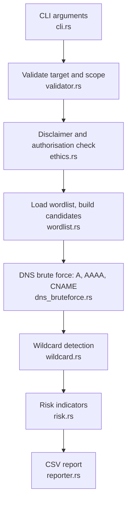

# SubHunter

**An educational subdomain enumerator written in Rust.**

SubHunter discovers subdomains of a target domain by DNS brute force, filters out wildcard DNS noise, flags hostnames that look sensitive (for example `admin`, `dev`, `staging`, `vpn`, `test`) and exports the findings to a CSV report.

| | |
|---|---|
| Course | IKB31603 Ethical Hacking, UniKL MIIT |
| Assignment | Ethical Hacking Tool Development (15%) |
| Team | HackBreak |
| Category | Offensive OSINT |
| Language | Rust |

> **Status: work in progress.** The project skeleton and module layout are in place. Features marked *(planned)* below are not implemented yet. This README is updated as each module is completed.

---

## Legal disclaimer

SubHunter is for **education and authorised security testing only**.

- Only run it against domains you **own** or have **explicit written permission** to test.
- Unauthorised scanning or enumeration may be an offence under the **Computer Crimes Act 1997 (Malaysia)** and similar laws in other countries.
- The authors accept **no liability** for misuse or for any damage caused by this tool. You are solely responsible for how you use it.

The tool shows this disclaimer at start-up and asks you to confirm that you are authorised before it sends any DNS query *(planned)*.

---

## Attack lifecycle mapping

SubHunter belongs to the **Reconnaissance** stage of the attack lifecycle (MITRE ATT&CK: *Reconnaissance*, technique T1590 *Gather Victim Network Information* / T1596 *Search Open Technical Databases*). It only performs DNS lookups, so it does not exploit, access or modify anything on the target.



Defenders can use the same output to find forgotten or exposed subdomains and reduce their attack surface before an attacker does.

---

## How it works



| Module | Purpose |
|---|---|
| `cli.rs` | Parses the domain, wordlist and output arguments |
| `validator.rs` | Checks the target domain is well formed and in scope |
| `ethics.rs` | Shows the legal disclaimer and requires authorisation confirmation |
| `wordlist.rs` | Reads and cleans the wordlist, builds candidate hostnames |
| `dns_bruteforce.rs` | Resolves candidates and records A, AAAA and CNAME results, handling errors and timeouts |
| `wildcard.rs` | Looks up random hostnames to find wildcard DNS and classifies each result as likely genuine, likely wildcard or uncertain |
| `risk.rs` | Flags hostname patterns that may expose sensitive systems, with a plain-language reason |
| `reporter.rs` | Writes the findings to CSV |
| `finding.rs` | Shared data types passed between the modules |

---

## Features

- DNS brute force with a user-supplied wordlist *(planned)*
- A, AAAA and CNAME record detection *(planned)*
- Handling of invalid domains, DNS errors and timeouts *(planned)*
- Wildcard DNS detection and classification *(planned)*
- Hostname risk indicators with reasons *(planned)*
- CSV export: hostname, DNS record, value, wildcard status, risk indicator *(planned)*
- Concurrent lookups with rate limiting *(planned)*

---

## Ethical safeguards

| Safeguard | Description |
|---|---|
| Legal disclaimer | Shown at every start-up *(planned)* |
| Authorisation confirmation | The user must confirm they are authorised to test the target *(planned)* |
| Scope validation | The target domain is validated before any query is sent *(planned)* |
| Safe defaults | Conservative rate limit and no external services by default *(planned)* |
| Local-only output | Results are written to a local file only, nothing is uploaded *(planned)* |
| Kill switch | `Ctrl+C` stops the scan cleanly and keeps results found so far *(planned)* |

### Rules of Engagement (RoE)

1. Test only domains you own, or those covered by a written authorisation that names the domain.
2. Keep the request rate low. Do not degrade the target's or the resolver's service.
3. Use `example.com` or a domain you own for demonstrations.
4. Do not publish findings about third-party systems.
5. Stop immediately if the owner asks you to.

---

## Installation

Requirements: [Rust](https://rustup.rs) (stable) and Git.

```bash
git clone <repository-url>
cd subhunter
cargo build --release
```

The binary is created at `target/release/subhunter`.

---

## Usage

Planned command line (arguments are already defined in `src/cli.rs`):

```text
subhunter --domain <DOMAIN> --wordlist <FILE> [--output <FILE>]
```

| Argument | Description | Default |
|---|---|---|
| `-d, --domain` | Target domain, for example `example.com` | required |
| `-w, --wordlist` | Path to the wordlist file | required |
| `-o, --output` | CSV report path | `output/report.csv` |

Example:

```bash
cargo run --release -- --domain example.com --wordlist wordlists/small.txt
```

Example CSV output *(illustrative, final columns may change)*:

```csv
hostname,record_type,value,wildcard_status,risk_level,risk_reason
www.example.com,A,93.184.216.34,likely_genuine,none,
dev.example.com,A,192.0.2.10,likely_genuine,medium,Development host may expose unfinished code
```

---

## Limitations

- Brute force only finds names that are in the wordlist.
- Results depend on the DNS resolver in use and on network conditions.
- Wildcard detection is a heuristic. Some results are classified as *uncertain*.
- Risk indicators are based on hostname patterns only. They are hints, not confirmed vulnerabilities.

---

## Responsible disclosure

If you find a security issue in SubHunter itself, please report it privately and do not open a public issue first.

- Contact: `<TODO: team contact e-mail>`
- Please include the version, steps to reproduce and the impact.
- We aim to acknowledge reports within 7 days.

If you use SubHunter and discover an exposed or sensitive subdomain belonging to someone else, report it to that organisation's security contact and do not share the details publicly.

---

## Screenshots

`<TODO: add screenshots of a run and the CSV report once the tool works>`

---

## Team HackBreak

- Muhammad Danial bin Mohd Zaki: DNS brute force engine
- Nurain Farzana binti Mohd Riduan: wildcard detection
- Ainin Sofiya binti Zamri: risk analysis and CSV reporting
- Amirah Zulaikha binti Abdul Hadi: CLI, ethics and integration

## License

Released under the [MIT License](LICENSE). Copyright (c) 2026 Team HackBreak.
