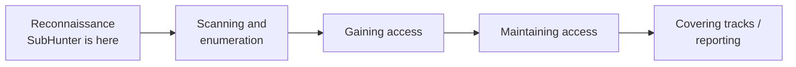
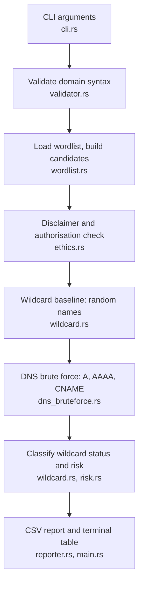

# SubHunter

**An educational subdomain enumerator written in Rust.**

SubHunter discovers subdomains of a target domain by DNS brute force, filters out wildcard DNS noise, flags hostnames that look sensitive (for example `admin`, `dev`, `staging`, `vpn`, `test`) and exports the findings to a CSV report.

| | |
|---|---|
| Course | IKB31603 Ethical Hacking, UniKL MIIT |
| Assignment | Ethical Hacking Tool Development (15%) |
| Team | HackBreak |
| Category | Offensive OSINT |
| Language | Rust |

> **Status:** all modules are implemented and tested (45 unit tests). Version 1.0.0 is in preparation.

---

## Legal disclaimer

SubHunter is for **education and authorised security testing only**.

- Only run it against domains you **own** or have **explicit written permission** to test.
- Unauthorised scanning or enumeration may be an offence under the **Computer Crimes Act 1997 (Malaysia)** and similar laws in other countries.
- The authors accept **no liability** for misuse or for any damage caused by this tool. You are solely responsible for how you use it.

The tool shows this disclaimer at start-up and asks you to type the target domain again to confirm that you are authorised. No DNS query is sent before you confirm.

---

## Attack lifecycle mapping

SubHunter belongs to the **Reconnaissance** stage of the attack lifecycle (MITRE ATT&CK: *Reconnaissance*, technique T1590 *Gather Victim Network Information* / T1596 *Search Open Technical Databases*). It only performs DNS lookups, so it does not exploit, access or modify anything on the target.



Defenders can use the same output to find forgotten or exposed subdomains and reduce their attack surface before an attacker does.

---

## How it works



| Module | Purpose |
|---|---|
| `cli.rs` | Parses the domain, wordlist and output arguments |
| `validator.rs` | Checks the target is a well-formed domain name (rejects URLs, IP addresses, wildcards and invalid labels) before anything else runs |
| `ethics.rs` | Shows the legal disclaimer and requires the user to retype the domain to confirm authorisation |
| `wordlist.rs` | Reads and cleans the wordlist, builds candidate hostnames |
| `dns_bruteforce.rs` | Resolves candidates and records A, AAAA and CNAME results, handling errors and timeouts |
| `wildcard.rs` | Looks up random hostnames to find wildcard DNS and classifies each result as likely genuine, likely wildcard or uncertain |
| `risk.rs` | Flags hostname patterns that may expose sensitive systems, with a plain-language reason |
| `reporter.rs` | Writes the findings to CSV |
| `main.rs` | Connects the modules, installs the Ctrl+C handler and prints the summary table |
| `finding.rs` | Shared data types passed between the modules |

---

## Features

- DNS brute force with a user-supplied wordlist (cleaned, de-duplicated, invalid names skipped)
- A, AAAA and CNAME record detection
- Handling of invalid domains, DNS errors and timeouts without crashing
- Wildcard DNS detection and classification
- Hostname risk indicators (high, medium, low, none) with a plain-language reason
- CSV export: hostname, DNS record, value, wildcard status, risk level and reason, with protection against CSV formula injection
- Concurrent lookups with rate limiting
- Summary table in the terminal with the same values as the CSV

---

## Ethical safeguards

| Safeguard | Description |
|---|---|
| Legal disclaimer | Shown at every start-up, before any network activity |
| Authorisation confirmation | The user must retype the exact target domain; anything else (or no input) stops the tool |
| Scope validation | The domain is checked first; URLs, IP addresses, wildcards and malformed names are rejected |
| Safe defaults | At most 10 lookups at a time, one new hostname every 50 ms, 3 s timeout, 2 attempts; only the system DNS resolver is used |
| Local-only output | Results go to a local CSV (default `output/report.csv`, ignored by git); nothing is uploaded. Values that could act as spreadsheet formulas are neutralised |
| Kill switch | `Ctrl+C` stops new lookups, lets running ones finish, and still saves the results found so far |

### Rules of Engagement (RoE)

Anyone running SubHunter agrees to these rules before the first query is sent.

#### Authorised scope
- Test only domains you own, or domains named in a **written authorisation** from their owner.
- The authorisation must list the exact domain(s). Subdomains of an authorised domain are in scope; other domains they point to (for example a CNAME to a cloud provider) are **not**.
- For demonstrations and class work use `example.com` or a domain the team owns.

#### Time windows
- Run scans only inside the time window agreed in the written authorisation.
- If no window is agreed, scan outside the owner's business hours and tell the owner before you start.
- Class demonstrations are run only during the lab session or the scheduled online defence.

#### Permitted techniques
- DNS queries for A, AAAA and CNAME records, sent through the system's normal DNS resolver.
- Querying hostnames built from a wordlist, plus a few random names for wildcard detection.
- The built-in safe defaults: at most 10 lookups at a time, one new hostname every 50 ms, 3 s timeout.

#### Prohibited actions
- Scanning any domain without written authorisation.
- Raising the rate limit or concurrency against infrastructure you do not own.
- Port scanning, vulnerability scanning, exploitation or login attempts against discovered hosts. SubHunter is reconnaissance only.
- DNS zone transfer (AXFR) attempts or attacks on the DNS servers themselves.
- Sharing, publishing or selling results about systems you do not own.

#### Emergency stop
- Press `Ctrl+C` at any time. Before the confirmation prompt this simply exits; during a scan no new queries are sent, lookups already in flight finish, and the results found so far are saved locally.
- Stop immediately if the owner asks you to, if you see errors or slow responses that suggest you are affecting their service, or if you discover you are outside the authorised scope.
- After an emergency stop, tell the owner what was run and when, and do not resume without their agreement.

---

## Installation

Requirements: [Rust](https://rustup.rs) (stable) and Git.

```bash
git clone https://github.com/Dannyz15/SubHunter.git
cd SubHunter
cargo build --release
```

The binary is created at `target/release/subhunter`.

---

## Usage

```text
subhunter --domain <DOMAIN> --wordlist <FILE> [--output <FILE>]
```

| Argument | Description | Default |
|---|---|---|
| `-d, --domain` | Target domain, for example `example.com` | required |
| `-w, --wordlist` | Path to the wordlist file | required |
| `-o, --output` | CSV report path | `output/report.csv` |

Example:

```bash
cargo run --release -- --domain example.com --wordlist wordlists/small.txt
```

Run `subhunter --help` for the full help text.

### Sample run (example.com, 20 Nov 2026)

```text
------------------------------------------------------------
SubHunter is for education and authorised security testing only.
...
------------------------------------------------------------
Type the domain again to confirm you are authorised to test it: example.com
[*] Target: example.com
[*] Wordlist: 15 words loaded
[*] Checking for wildcard DNS...
[*] Brute force finished: 15 queried, 1 resolved, 0 timeouts, 0 errors
[*] Classifying results...
[+] Report saved to: output/report.csv

[*] Found subdomains:
HOSTNAME                       TYPE   VALUE                                    WILDCARD         RISK
www.example.com                A      172.66.147.243                           likely_genuine   none
www.example.com                A      104.20.23.154                            likely_genuine   none
www.example.com                AAAA   2606:4700:10::ac42:93f3                  likely_genuine   none
www.example.com                AAAA   2606:4700:10::6814:179a                  likely_genuine   none
```

The CSV report from the same run:

```csv
hostname,record_type,value,wildcard_status,risk_level,risk_reason
www.example.com,A,172.66.147.243,likely_genuine,none,
www.example.com,A,104.20.23.154,likely_genuine,none,
www.example.com,AAAA,2606:4700:10::ac42:93f3,likely_genuine,none,
www.example.com,AAAA,2606:4700:10::6814:179a,likely_genuine,none,
```

example.com only publishes `www`, so every risk level is `none`. A host such as `dev.example.com` would be reported with risk `medium` and the reason "Development or staging host may expose unfinished code or debug features". The IP addresses change over time because example.com is served through a CDN.

---

## Testing

```bash
cargo test                             # 45 unit tests, no network needed
cargo test -- --ignored --nocapture    # 4 live tests against example.com (needs internet)
```

The live tests resolve real and non-existent names, check that example.com has no wildcard, and run the whole pipeline into `output/report.csv`.

---

## Limitations

- Brute force only finds names that are in the wordlist.
- Results depend on the DNS resolver in use and on network conditions.
- Wildcard detection is a heuristic. Some results are classified as *uncertain*.
  - A real host that shares an IP address with the wildcard answer (for example the same web server) is classified as *likely wildcard*.
  - On CDNs and large hosting providers, many results are *uncertain*, because any IP in the same /24 (IPv4) or /64 (IPv6) as the wildcard answer is treated as uncertain.
  - A wildcard that returns very different IPs on each query can be missed, because only 3 random names are probed.
  - If the random probes time out, the tool prints a warning and the wildcard status of the results cannot be trusted.
- Risk indicators are based on hostname patterns only. They are hints, not confirmed vulnerabilities.

---

## Responsible disclosure

If you find a security issue in SubHunter itself, please report it privately and do not open a public issue first.

- Report it through GitHub's private vulnerability reporting: open the repository's **Security** tab and choose **Report a vulnerability**. Only the maintainers can see the report.
- Please include the version, steps to reproduce and the impact.
- We aim to acknowledge reports within 7 days.

If you use SubHunter and discover an exposed or sensitive subdomain belonging to someone else, report it to that organisation's security contact and do not share the details publicly.

---

## Team HackBreak

- Muhammad Danial bin Mohd Zaki: DNS brute force engine
- Nurain Farzana binti Mohd Riduan: wildcard detection
- Ainin Sofiya binti Zamri: risk analysis and CSV reporting
- Amirah Zulaikha binti Abdul Hadi: CLI, ethics and integration

## License

Released under the [MIT License](LICENSE). Copyright (c) 2026 Team HackBreak.
